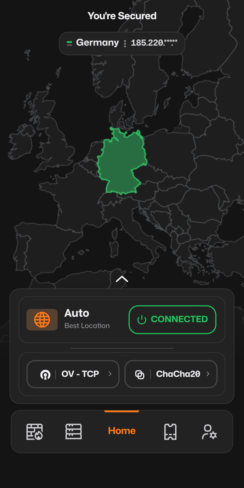
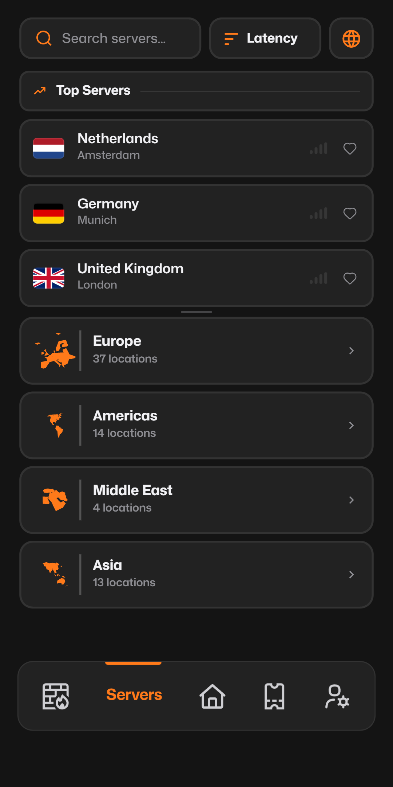
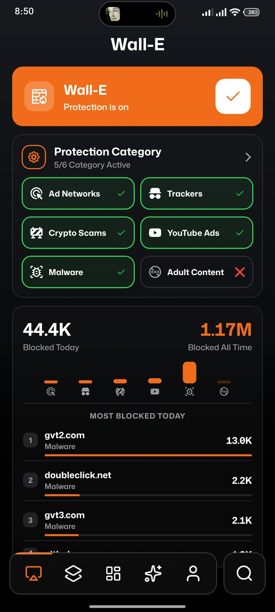
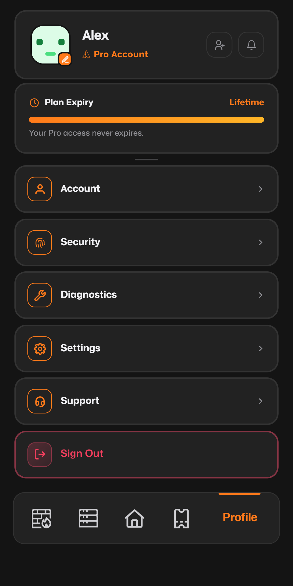

# Astrix VPN

**Fast, private, multi-protocol VPN for Android.**

---

  &nbsp;&nbsp;
  

  &nbsp;&nbsp;
  

---

## Features

- **Multiple protocols** — WireGuard, AmneziaWG, OpenVPN (UDP/TCP), HyperFlow, and SecLink.
- **Global server network** — 150 locations with live latency, search, favorites, and one-tap Auto connect.
- **Wall-E protection** — DNS-level blocking for ads, trackers, malware, crypto scams, and adult content with live stats.
- **Split Tunneling** — Choose which apps go through the VPN.
- **Built-in tools** — Speed test, connection diagnostics, home-screen widgets, and Quick Settings tile.
- **Modern Glass UI** — Native Android interface with dark & light themes and multi-language support.
- **In-app updates** — Automatic architecture-matched updates directly inside the app.

---

## Download

Get the latest APK from the [Releases page](https://github.com/zikzee632-hash/MetrixVPN/releases):

| File | Architecture |
|---|---|
| `MetrixVPN-v<version>-arm64-v8a.apk` | 64-bit (`arm64-v8a`) — most modern phones |
| `MetrixVPN-v<version>-armeabi-v7a.apk` | 32-bit (`armeabi-v7a`) — older devices |

---

© Astrix VPN · <a href="mailto:support@metrixvpn.app">support@metrixvpn.app</a>

